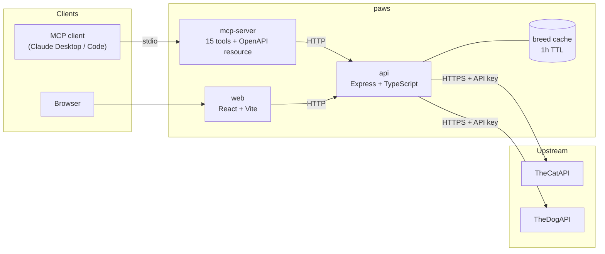

# paws

All paws, no bite: TheCatAPI and TheDogAPI in one friendly API, with an MCP server and web
app. Built while learning how to build [MCPs](https://modelcontextprotocol.io).

| Folder | What it is |
| --- | --- |
| [`api/`](api) | Express + TypeScript service that aggregates TheCatAPI and TheDogAPI |
| [`mcp-server/`](mcp-server) | MCP server exposing the API's endpoints as tools for Claude and other MCP clients |
| [`web/`](web) | React + Vite frontend (scaffold, not yet wired to the API) |

## Architecture

## Getting started

**Prerequisites:** free API keys from [TheCatAPI](https://thecatapi.com) and
[TheDogAPI](https://thedogapi.com). TheDogAPI rejects most requests without one. Add them to
`api/.env` (copy `api/.env.template`).

See each folder's README for setup.
